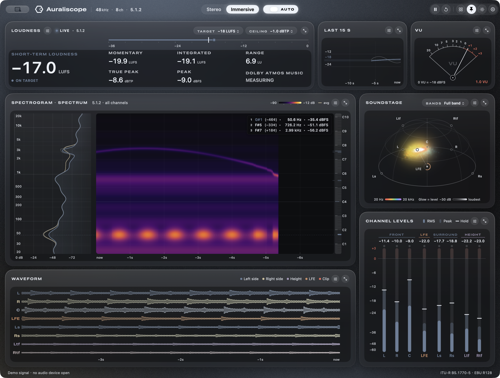

# Auraliscope

**Auraliscope 2.0 · build 91** — audio metering, spatial analysis and loudness reports for macOS.

Measure an audio input, system playback or a DAW bus in one view. Auraliscope combines loudness, true peak,
spectrum, spectrogram, waveform, channel levels and Soundstage, with layouts that adapt to the way you work.

[Download 2.0](https://github.com/jinboz12/Auraliscope/releases/tag/v2.0) · [Release notes](RELEASE_NOTES.md) ·
[Installation and upgrades](docs/INSTALLATION.md) · [Validation](docs/2.0_BUILD91_VALIDATION.md)



## What is new in 2.0

- **DAW integration.** Auraliscope Bridge measures inside the host and sends analysis results to the app. Audio passes
  through unchanged. Each insert keeps its own measurement, even with the app closed. VST3 supports named layouts
  from mono and stereo through 9.1.6; the Audio Unit supports mono and stereo.
- **Soundstage.** Stereo imaging and immersive views with frequency-coloured Radiant particles or a continuous
  Level body, camera views, band selection and hover readings. These are visualizations of channel signals, not
  measurements of the listening room or a Dolby Atmos renderer.
- **Flexible layouts.** Enlarge, hide or detach panels, save named layouts, and use a horizontal strip along the
  bottom of the display. Choose 30 fps or automatic power-aware display updates.
- **Loudness and master reports.** Export a three-page PDF or CSV covering loudness, peaks, dynamics, tonal balance,
  bandwidth, stereo image and signal integrity, including DC offset and infrasonic energy.
- **Meter controls.** LUFS or relative LU, EBU +9/+18 scales, custom targets and ceilings, configurable history,
  channel peak hold and release, VU calibration and variable spectrum smoothing.
- **Refined presentation.** The 2.0 icon, Light and Dark appearances, restrained colour themes, and English,
  Simplified Chinese and Korean interfaces.

## Download and install

Requires **Apple silicon and macOS 13 or later**. The desktop app is arm64; the plugins contain arm64 and x86_64
slices, but Intel hosts are not validated for this release. A full Xcode installation is needed to build the icon assets.

Use **Auraliscope 2.0 build 91.pkg** for the app and optional VST3/AU plugins. Quit the app and DAW first. The installer
updates `/Applications/Auraliscope.app` and the selected system plugin formats. Separate ZIPs are available for manual
installation. Download `SHA256SUMS.txt` alongside the assets to verify them with `shasum -a 256 -c SHA256SUMS.txt`.

This release is **ad hoc signed, with an unsigned installer, and is not notarized**. If macOS blocks it, verify the
GitHub source and use System Settings → Privacy & Security → Open Anyway. See the installation guide for details.

Upgrading from LABS: install the new app **and** both plugin formats you use. LABS keeps its separate name, settings
and permissions; it is not removed. Public 2.0 plugins connect to the normal app. DAW plugin identifiers are retained
so existing project inserts can resolve to the upgraded plugin. Save a backup of important projects before upgrading.

## Start measuring

1. Open Settings → Audio and select **Audio devices** or **Host plugins**.
2. For devices, select the input or output to meter and grant the audio permission macOS requests. For a DAW, insert
   **Auraliscope Bridge**, open its editor and click **Open Auraliscope**. Select an insert when several are available.
3. Choose Stereo or Immersive, the intended loudness reference and your layout. Reset before measuring a full programme.
4. Export with **⌘E** for PDF or **⇧⌘E** for CSV. Use **⌘1…⌘7** to enlarge panels, Esc to restore, and **⌥⌘S** for the strip.

Pause and Reset on a plugin source control that insert's measurement. Offline renders are passed through but are not
metered. Interruptions are shown; reset for a continuous programme measurement.

## Understanding results

PASS checks the selected loudness target and true-peak ceiling; it does not certify a complete delivery specification.
Report NOTE/CHECK thresholds are mastering guidance and need interpretation for the material. Streaming values are
references, not guaranteed playback predictions. Netflix uses dialogue loudness, which this meter does not implement:
its result is explicitly **REFERENCE**, never PASS. ARIB's preset is also a reference pending verification of the full
current specification. Amazon Music is no longer asserted to share the −14 LUFS preset. See [reference notes](docs/LOUDNESS_REFERENCES.md).

The analysis uses BS.1770 loudness gating and EBU loudness-range conventions. Synthetic tests are documented in the
validation report; no standards certification or broad DAW certification is claimed.

## Privacy

Audio is analyzed in memory on your Mac. Bridge sends analysis results over a local, same-user socket rather than
sending PCM audio to the app. There is no cloud audio processing. Reports and images are written only on request.
The plugin's optional Network Preview performs discovery only when Scan is clicked; remote analysis reception is not
part of 2.0. The app runs outside App Sandbox to support its local Bridge connection.

## Build and check

```sh
scripts/test.sh
Bridge/scripts/test-transport.sh
Bridge/scripts/test-analysis.sh
scripts/package-app.sh
```

Run from the repository root. Plugin SDKs are fetched at pinned revisions by `Bridge/scripts/fetch-sdks.sh`.
Release artifacts are written to `dist/2.0 ver/2.0 build 91/`. Build versions are in
`Bridge/scripts/release-version.sh` and `Resources/Info.plist`; the packaging check requires them to agree.
For plugin architecture and host checks, see [Bridge](Bridge/README.md).

## Copyright and notices

Copyright © 2026 JINBOZ. All rights reserved. Auraliscope is not offered under an open-source license.
See [COPYRIGHT.md](COPYRIGHT.md) for usage terms and [third-party notices](docs/THIRD_PARTY_NOTICES.md) for SDK licenses
and trademarks. Issues and reproducible bug reports are welcome on [GitHub](https://github.com/jinboz12/Auraliscope/issues).
