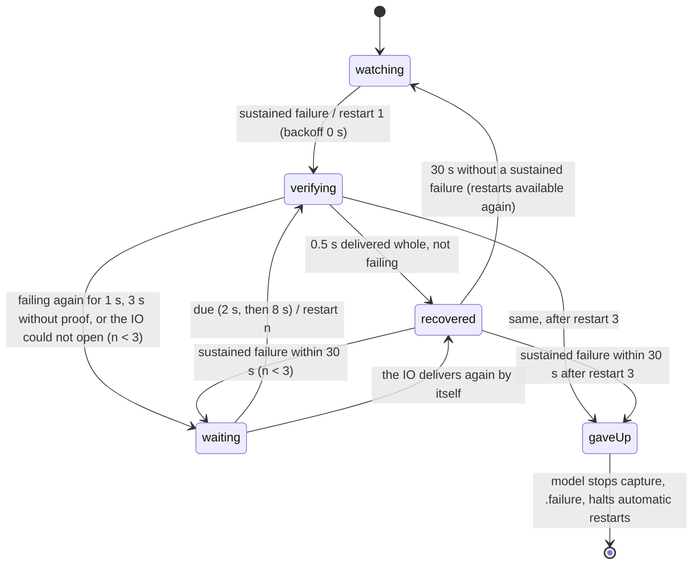

# Phase 7 final report: capture recovery (P0-1)

Branch `maintenance/phase7-capture-recovery`, based on `9333796` (the verified Phase 6 HEAD), in its own worktree
(`/Volumes/Backup/VIBECODING/Auraliscope-phase7`). Local commits only: nothing was pushed, merged, tagged, packaged or
released, and the build number is unchanged. `CaptureSession` was not extracted. The primary checkout (`main` at
`a11b325` with the uncommitted Build 119), the maintenance, Phase 5 and Phase 6 worktrees and their records, and the
branches `main`, `maintenance/commit-series`, `maintenance/phase5-architecture` and `maintenance/phase6-correctness`
were not modified. Chronology: `PHASE7_LOG.md`; state: `PHASE7_STATE.json` (both kept uncommitted, as before).

**What changed for the person using the app.** A device capture whose IO keeps failing (refused by the device on every
cycle, or slices longer than the capture's storage) no longer stays silent under a status that says "capturing". After
a second of lost audio it is restarted, at most three times, and the status says so; when the restarts do not bring
audio back, capture stops and the status says why and to choose Start Capture. Every lost frame is still counted and
marked as before. Nothing else changes: rate notifications, device loss and return, pause, source switching and DAW
plugins behave as in Phase 6.

**What is verified.** Only with stand-ins and the real IO callbacks driven without a device. No real audio interface,
output tap or rate change was used (section 8 lists what that leaves unverified, section 9 how to check it).

## 1. Recovery state machine

The proposal's conceptual states map onto the code as follows. Two are moments inside one main-thread call rather than
states that persist, and two are states the model already had; adding them again would duplicate state.

| Brief's state | In the code |
|---|---|
| Healthy | `CaptureRecoveryPolicy.Phase.watching` (no episode) or `.recovered(attempts:since:)` (healthy, episode still open) |
| FailureDetected | The reading at which a run becomes sustained: the transition out of `watching`/`recovered` |
| RecoveryScheduled | `.waiting(attempt:due:failure:delivered:)` |
| Restarting | Synchronous: `MeterModel.recoverCapture`, within one main-thread call |
| AwaitingValidCapture | `.verifying(attempt:started:failure:)` |
| RecoveryFailed | The model's: capture stopped, `.failure` status, `recoveryHalted == selectedID` |
| StoppedByUser | The model's existing `wantsCapture == false` or no source selected: the policy is reset and not consulted |



Two rules apply in every state:
- **Another capture session ends the episode.** `MeterModel.captureSession` changes on every `stop()` and `pause()`, so
  on every start other than recovery's own. A pause, a stop, another source, a configuration notification's restart,
  the person's Start Capture or reset: at the next reading `observe` sees a session it did not make and returns to
  `watching`. A pending restart is part of the policy's state, not a timer or closure, so it can never fire for another
  capture. A restart recovery makes itself keeps the session; a fresh start it makes (new rate) is adopted.
- **Only an eligible capture is watched.** A device source, capture wanted, not the demo, running (or held by an
  episode). Otherwise the policy is reset: paused or stopped capture, Host plugins and DAW plugin sources are never
  touched.

**One recovery at a time.** There is no concurrency to arbitrate. Decisions are made at a reading on the main thread, a
decision moves the phase on before the restart runs (so a second reading cannot repeat it), and the restart runs
synchronously in the same call.

**No partially initialised resources.**
- `AudioCapture.restart` closes the old IO first. A failed reopen closes whatever it opened (unit, tap, aggregate,
  storage), leaves the ring as it was, and the attempt counts as failed.
- A failed fresh start leaves no analysis behind. That is the existing `restart()`, and the lifecycle check "three
  failed starts" covers it.

## 2. Detection and retry policy

All in `CaptureRecoveryPolicy.Thresholds` (internal constants, no preference):

| Parameter | Value | Why |
|---|---|---|
| Sustained failure | One failing run that lost ≥ 1.0 s of audio (frames / capture rate) over ≥ 3 callbacks | Far beyond a rate notification's own restart (a main-queue hop, a device-list read, a unit restart), so that path acts first. Measured in audio lost, so late or coalesced readings (a hidden app) change nothing. The slice count stops one huge slice from counting. |
| Restarts per episode | 3 | Covers a rate change racing a restart plus one retry, then a person decides. |
| Backoff | 0 s, then 2 s, then 8 s, each after the previous attempt failed | The failure has already lasted a second when it is detected, so the first restart is immediate. Later ones give a device mid-reconfiguration time to settle. Worst case from the start of a failure to giving up is about 14 s (1 + ~1 + 2 + ~1 + 8 + ~1), or 20 s when restarts deliver nothing (1 + 3 + 2 + 3 + 8 + 3). |
| A restart worked | Its IO delivered ≥ 0.5 s of audio whole and is not failing | Success is audio the device actually delivered, not a unit that opened. Silence counts: the capture is checked, not the signal. |
| Verification time | 3 s | A restart that delivers nothing at all (a stall) or keeps flapping is a failed attempt, not a success by default. |
| Episode end | 30 s after a restart that worked, with no sustained failure | Restores the budget only after a well-defined healthy interval. The other refill is a person's action: Start Capture, another source, or reset. A configuration notification's fresh start is also a new session. |
| Storage after slices too long | At least the newest largest slice, capped at 65,536 frames (64 ch: 16 MiB) | The next IO must hold what the device delivers. Sized from the newest reading at the restart, so a buffer that grew again is followed. |

**Classification**, from the run's failure bits (`CaptureHealthReading.run_failures`):
- Slices too long, or a tap delivery cut: `capacity(largest)`.
- Otherwise: `refused(OSStatus)`.

The device's state decides the remedy at the restart, from the latest hardware parameters:
- **Device gone:** the device list is read first, and a source that vanished goes to the device list's own path ("No
  audio device", restored when it returns).
- **Rate changed:** the IO reopens at the device's current rate. A rate different from the analysis' starts the
  analysis afresh, exactly as the rate notification path does. The capture reopened at the new rate is stopped first,
  so its audio never reaches the old analysis.
- **Otherwise:** the IO reopens on the same ring and the analysis carries on.

**Failure classes A–F** (brief, section 3):

| Class | Handling |
|---|---|
| A. Rate mismatch | The rate notification's restart, unchanged. Recovery acts only if no notification restarted the capture within 1 s, and its restart then starts afresh at the new rate. |
| B. IO buffer-size change | Nothing to do while slices fit. A restart re-reads the buffer size. No new listener: a change that does not make slices outgrow storage needs no restart, and one that does is class C. |
| C. Slices longer than the storage | `capacity`: a capture-only restart with larger storage. |
| D. Temporary interruption | A run under 1 s, or a few slices: counted and marked as before, no action. |
| E. Disconnection | The device-list path. Recovery stands down: the source is deselected, the session changes, or the attempt's device-list read finds the device gone. |
| F. Pause, stop, switching | Intentional. The session changes or the capture is no longer eligible, so the episode ends and no pending restart survives. |

**Not added, on purpose:**
- **Coalescing of rate/alive notifications.** There is no evidence of bursts, and the existing path already reads the
  latest parameters at each restart.
- **A buffer-size listener.** See class B.
- **`kAudioUnitProperty_MaximumFramesPerSlice`.** Setting it would change every capture start, without hardware evidence
  that it is needed (section 8).
- **Detection of a callback stall** (no callbacks at all while capturing). Whether an idle output tap keeps calling its
  IOProc is unknown, so a stall is never a trigger. It counts only against a restart being verified.

## 3. Source files

| File | Commit | Change |
|---|---|---|
| `Sources/AudioRing/include/CaptureCallback.h`, `Sources/AudioRing/CaptureCallback.c` | 1 | `CaptureHealth` record: written by the IO callbacks with relaxed atomics (single writer), read with `capture_health_read` |
| `Sources/Auraliscope/AudioCapture.swift` | 1 | `health()`; `restart(device:sourceForRole:minimumFrames:)` reopens the IO on the same ring; `stop()` split into `closeIO()` plus the ring's count and clear; storage minimum |
| `Sources/Auraliscope/MeterModelDependencies.swift` | 1 | `CaptureBackend.restart`, `health()`; `clock` |
| `Sources/Auraliscope/CaptureRecovery.swift` (new) | 2 | `CaptureRecoveryPolicy` |
| `Sources/Auraliscope/MeterModel.swift` | 1, 2, 3 | 1: `deviceConfigurationChanged()` extracted unchanged. 2: `superviseCapture`, `recoverCapture`, `giveUpCapture`, status, `captureSession`, `recoveryHalted`, the device-list guard, `MeterStatus.recovering`. 3: the QA-only flag |
| `Sources/Auraliscope/Readouts.swift` | 2 | The 10 Hz tick calls `superviseCapture()` |
| `Resources/Localization/*.lproj/Localizable.strings` | 2 | 4 keys × 6 languages |
| `Sources/Auraliscope/ModelLifecycleSelfTest.swift` | 1, 2 | Stand-in capture: ring semantics, health reading, restart, clock. 36 recovery checks |
| `Tests/AuraliscopeTests/CaptureRecoveryChecks.swift` (new), `CoreTests.swift`, `scripts/test.sh` | 1, 2, 3 | Health-record and policy checks; the concurrency harness in the core run |
| `Tests/CaptureHealthConcurrency.c` (new) | 3 | The record across two threads |
| `Sources/Auraliscope/CaptureSelfTest.swift` | 3 | `--capture-selftest` also restarts the IO as recovery does and measures again |
| `Sources/Auraliscope/Diagnostics.swift` | 3 | `--ignore-configuration-changes` (QA bundles only), for the manual check of a missed notification |
| `docs/maintenance/*`, `AGENTS.md` | 4 | This report, the proposal's status, the new invariants |

Not touched: the DSP and analysis core, the ring (`AudioRing.c`), the snapshot layout, the plugin and its protocol,
settings keys, routing, Multi-FFT, the UI layout.

## 4. Local commits

```
687b505 test(capture): health record in the IO callbacks, and seams for capture recovery checks
4b49d6f fix(capture): restart a device capture that keeps failing, a bounded number of times (P0-1)
db38213 test(capture): two-thread health record check, restart in the capture self-test, QA flag for missed notifications
```

This report is committed after them, with the proposal's status line and `AGENTS.md`. Each commit's tree is the tree
that was verified.

## 5. Regression tests added

**Core checks** (`scripts/test.sh`, part of `check-all`):
- Health record (`CaptureRecoveryChecks`). The real callbacks are driven without a device. Each slice kind is checked
  in a failing capture's order: oversize, refused twice (an uninitialised AUHAL), a whole tap delivery ending the run,
  a cut delivery, a whole direct-path delivery. The ring's counts are checked beside the record's, unchanged. Also: a
  reset, and a context with no record.
- Policy (table-tested with chosen readings and times):
  - what is and is not sustained (0.99 s; 5 s in 2 slices; healthy; nothing);
  - one restart per decision (20 readings after it decide nothing);
  - verification by audio (0.4 s is not proof, 0.5 s is);
  - the episode's end at 30 s, and a full budget after it;
  - backoff 2 s and 8 s;
  - a restart that cannot open; one that delivers nothing for 3 s;
  - giving up after 3, and giving up at once when a failure follows a third restart that worked;
  - a capture coming back by itself while a restart waits (cancelled);
  - a session change dropping a pending restart; an adopted session carrying the episode;
  - storage sized from the newest slices.
- Concurrency (`Tests/CaptureHealthConcurrency.c`): 200,000 tap deliveries on one thread, alternating whole and cut,
  while another thread reads the record and drains the ring. Counters only grow, the run is never longer than one
  delivery, and the final record is exact. It also runs under ThreadSanitizer and AddressSanitizer (section 6).

**Model lifecycle** (`--test-model-lifecycle`; Phase 6: 127 checks, now 163), with the stand-in capture's health
reading set by the checks and the model's clock moved by hand, so nothing waits. The brief's 15 scenarios:

| # | Scenario | Check(s) |
|---|---|---|
| 1 | Single transient failure | A passing glitch, 0.99 s of refusals, or 5 s in two slices restart nothing |
| 2 | Continuous refusal | Refusal lasting 1 s → one capture-only restart, at once, same analysis, status "restarting it (attempt 1 of 3)" |
| 3 | Success on the first attempt | 0.5 s delivered whole → capturing again, same analysis |
| 4 | Success on a later attempt | Restart 1 fails again; restart 2 comes after 2 s (not at 1.8 s) and works |
| 5 | Attempts exhausted | A restart that cannot open, one that delivers nothing for 3 s, one that fails again → capture stops, the status names the reason and Start Capture; nothing restarts it (device-list change, 60 s); Start Capture measures afresh with the full budget |
| 6 | Stopped during a scheduled retry | No device chosen while restart 2 waits → no restart, no start |
| 7 | Paused during recovery | Paused while restart 2 waits → no restart; resume carries the analysis on, nothing left over |
| 8 | Source changes during recovery | Another source while restart 2 waits → no restart |
| 9 | Device disappears during recovery | The device gone when restart 2 is due → no restart, "No audio device"; its return is measured again |
| 10 | Rate changes during recovery | A notification while restart 2 waits → fresh at 44.1 kHz, the pending restart never comes; no notification → the restart finds the new rate and starts afresh |
| 11 | Buffer size changes during recovery | Oversize slices → restart with storage for 8,192, the next for the newest 12,000 |
| 12 | Stale retry after a new session | Another source, then the first again while a restart was pending → no restart reaches either |
| 13 | No duplicate restarts | Ten readings at once, then five more with short failures → one restart |
| 14 | Healthy state restored | Capturing again after verification; 30 s later a new failure starts from restart 1 |
| 15 | Drops and breaks preserved | 48,000 frames lost before the restart stay in the ring's count and `droppedFrames` (nothing reset or counted twice); one break carrying all 48,000 frames is marked where the restarted capture writes first |

Also: Host plugins, which recovery never touches.

**Fail-first.** The lifecycle recovery checks ran on commit 1 with an empty `superviseCapture()`. The first scenario
failed ("a refusal lasting 1 s restarts the capture alone…", status still "Capturing"); every later scenario depends on
that restart (`output/phase7/2-red.log`).

**Mutations** (`output/phase7/mutate.py`): 9 of 11 caught.

| Mutation | Caught by |
|---|---|
| A session change ignored (cancellation, stale session) | Model: "another source chosen: the pending restart never comes"; core |
| No retry limit | Model: the give-up check; core |
| A fresh session not adopted | Model |
| The give-up halt ignored | Model: "nothing restarts it by itself" |
| Verified by opening, not by audio | Model; core |
| A restart left pending (duplicates) | Model; core |
| The ring cleared by the restart | Model |
| The run kept after a whole slice | Core |
| The slice count ignored | Model; core |

Two survive, both guards that another one covers:
- **No reset while supervision stands down.** The next eligible reading sees another session and resets the policy.
- **No session re-check after the attempt's device-list read.** That read can change the session only by deselecting
  the device, which the selected-device check catches.

## 6. Verification

Final code state: `db38213`. Logs are in `output/phase7/`.

| Step | Phase 6 baseline (`9333796`) | Phase 7 (`db38213`) |
|---|---|---|
| `scripts/check-all.sh` | 9/9 | 9/9 (build-debug, shaders, core-checks, build-release, app-features, file-analysis, bridge-analysis, spatial-report, bridge-transport) |
| Core checks (`scripts/test.sh`) | 61 core checks, baseline (golden digests), kernels; localization 924 keys | Same, plus 2 capture recovery checks and the concurrency harness; localization 928 keys |
| `scripts/check-model.sh` | worker 14/14, lifecycle 127 | worker 14/14, lifecycle 163, three runs in a row with the same results |
| QA suite (`output/phase7/qa-suite.sh`) | All pass | All pass: settings-presets 10, settings-draft 13, multifft-layout 36, pause 11, model-worker demo and live 14, model-lifecycle 163 + completion, spectrum-average, peak-reset, nebula-gpu, spatial-projection; Multi-FFT hidden in a fresh domain |
| AddressSanitizer app build | Model self-tests clean | model-worker 14, model-lifecycle 164 PASS lines, 0 reports |
| ThreadSanitizer app build | Model self-tests clean | model-worker 14, model-lifecycle 164 PASS lines, 0 reports |
| `Bridge/scripts/test-transport.sh` under TSan and ASan | Pass, 0 reports | Pass, 0 reports |
| Health record across two threads, plain, TSan and ASan | n/a | Pass, 0 reports |
| Fail-first and mutations | n/a | Red on commit 1 with an empty hook; 9 of 11 mutations caught (section 5) |
| `--ignore-configuration-changes` | n/a | With it, the lifecycle run fails exactly at the rate-notification scenario, and the log records the change as ignored; without it, everything passes |

Each commit passed the full suite before it was made (`check-all`, the model checks and the QA suite).

Against the Phase 6 baseline (`9333796`): the same steps pass. Three counts grew:
- lifecycle: 127 → 163;
- core: two capture recovery lines and the concurrency harness;
- localization: 924 → 928 keys.

The golden pipeline digests are bit-identical (core checks).

**Not run:**
- `--capture-selftest` on a loopback device (REAPER was open and might use the loopback devices; the test plays tones
  into a device and may ask for microphone permission).
- `capture-render-probe.sh`; any rate change, unplugging or tap.
- `scripts/test.sh address|thread` as a whole. The record's code under the sanitizers is covered by the harness above.
  Under ASan the Enhanced golden differs by design (Phase 6), and the full TSan core run did not finish in Phase 2.

## 7. Performance and threading

**IO thread.** Each callback adds at most:
- relaxed loads and stores on the record: two counters, the largest slice, and three run fields reset (or three run
  fields added to);
- no read-modify-write, fence, lock, allocation, logging, Objective-C or Swift.

This is negligible beside `AudioUnitRender`. `AGENTS.md`'s real-time rules hold. The ring's `channel_ring_lose`
accounting is unchanged.

**Main thread.**
- **Every 0.1 s:** eight relaxed loads and a few comparisons (`Readouts` tick → `superviseCapture`).
- **A restart:** closing and opening the AUHAL or tap (tens of milliseconds) and a device-list read, at most 3 per
  episode. The analysis' DSP queue is not paused: the ring is not cleared, so the consumer never races a clear.
- **App Nap:** the 10 Hz tick is a `.common`-mode run-loop timer that runs without windows. A hidden app may see it
  coalesced, which delays decisions (backoff times stretch) but does not change detection, which is measured in audio
  lost.

**Ring producer across a restart.** The old IO is stopped and disposed (or its IOProc destroyed) before the new one
starts, so the ring's producer-only fields pass from one IO thread to the next through Core Audio's own
synchronisation. Every start already relied on this. The two-thread harness shows the record race-free; the handoff
itself needs a device (section 9, H1).

**Memory.** Unchanged, except storage of up to 16 MiB after a capacity failure on 64 channels.

**Accounting.**
- Capture-only restart: the analysis is not reset. The frames lost stay counted once (`channel_ring_lose`, as before)
  and reach the analysis as one break with their missing seconds.
- Fresh start (new rate): drops count from zero with the new analysis, as on the notification path. The frames lost
  before it are written to the diagnostic log first.
- The restart's own gap, while no callback runs (tens of milliseconds), is not added to the missing seconds. The
  analysis still sees a break, so no window joins audio across it.

## 8. Remaining hardware-dependent risks

1. **Notification latency against the 1 s threshold.** Unmeasured (H3). If a rate notification's restart took longer
   than 1 s, recovery would act first: its restart finds the new rate and starts afresh, then the notification starts
   afresh again. That is two fresh starts, and harmless.
2. **`AudioCapture.restart` on real devices.** The ring handoff, no leak, and how long a tap aggregate takes to be
   recreated. Covered by the extended `--capture-selftest` (H1), which was not run.
3. **Idle output taps.** If a tap whose tapped device is idle stops calling its IOProc, a restart of a tap that had
   failed would deliver nothing, fail verification three times and give up. A healthy idle tap is never touched,
   because detection needs failed callbacks.
4. **AUHAL slice limit.** `kAudioUnitProperty_MaximumFramesPerSlice` is not set. A device delivering slices above the
   AUHAL's limit may be refused with −10874 even after the storage grows. It is then classified as refused, and after
   three restarts the status shows that OSStatus. Slices above 4,096 frames could not be produced here.
5. **Mid-recovery events:** the device unplugged during a restart, microphone permission revoked, sleep and wake, or a
   coreaudiod restart (not observed). Each should end as an attempt that failed or as the device-list path, but none
   was exercised.
6. **Flapping failures.** Runs shorter than 1 s that keep recurring never trigger recovery, by design. They stay
   counted and marked.
7. **A capture down mid-episode.** A configuration notification that arrives while the capture is down after a failed
   fresh start (not running) is not acted on (unchanged rule: only a running capture restarts). The next scheduled
   restart reads the new configuration.
8. **Pre-existing, outside recovery.** A tap start that fails after creating its private aggregate destroys it again.
   Both changes post device-list notifications, and `refreshDevices` retries a start whenever capture is wanted and not
   running, so it could retry without bound. Recovery's give-up is guarded against this path; plain failed starts are
   as before. Not reproduced.

## 9. Manual hardware validation

**Setup.**
- Build with `swift build`.
- Stage a QA bundle as `output/phase7/qa-suite.sh` does (`stage com.jinboz.SoundMeterJBZ.QA <path>`), and launch
  `<path>/Contents/MacOS/Auraliscope -showWelcomeOnLaunch NO` from Terminal. Real devices, QA preference domain.
- Grant the QA bundle microphone access (input devices) and System Audio Recording (taps).
- Diagnostic log: the newest file in `$(getconf DARWIN_USER_TEMP_DIR)Auraliscope-QA-Logs/`. Lines to find: `Capture
  keeps failing`, `Capture recovery: restart`, `Capture recovered`, `gave up`, `Stream:`.
- Quit any DAW using the device under test.

| # | Check | Expect |
|---|---|---|
| H1 | `Auraliscope --capture-selftest 141` (an idle Pro Tools Audio Bridge 2-A), then `--capture-selftest 141 --output` | Both runs: "every role reads its routed input" twice and "both IOs delivered whole slices, none failed, and the ring kept its count across the restart" |
| H2 | Capture an interface input (UltraLite-mk5) for 10 min, with silence and with programme | No recovery lines; dropped frames 0; silence does not trigger anything |
| H3 | Change that interface's rate in Audio MIDI Setup while capturing (48 → 44.1 kHz); then four changes within 10 s | Each: `Stream: 44100 Hz` (or the new rate). Note the delay from the change; the 1 s threshold should be ≥ 3× it. No recovery lines, no give-up |
| H4 | Relaunch with `--ignore-configuration-changes` and change the rate | Within about 1–1.5 s: `Capture keeps failing (refused, OSStatus …)` (−10863 in the Phase 2 probe), `restart 1 of 3`, `the device runs at 44100 Hz now; the analysis starts afresh`, `Capture recovered after restart 1`. The status shows "restarting it (attempt 1 of 3)", then capturing at the new rate; meters live |
| H5 | H4 with an output source (tap) on a device whose rate can change, with something playing | Either recovery as in H4, or no failure at all (a tap may keep delivering at its aggregate's rate). Record which. A tapped device's rate change produces no failed slice, so recovery cannot see a missed notification there |
| H6 | Unplug a USB interface while capturing; plug it back in | "No audio device available", no restart lines after the device went; measured again on return |
| H7 | With the flag: change the rate, then unplug within about 2 s | The device-list path takes over ("No audio device"); no restart on the missing device |
| H8 | With the flag: change the rate and press Pause while "restarting it" shows; then Resume | No restart after the pause; Resume measures (afresh if the rate changed) |
| H9 | Hide (⌘H) or minimise the app, change the rate with the flag, wait 30 s, show it | Log timestamps give the detection delay under App Nap; capture recovered |
| H10 | Sleep the Mac for 1 min while capturing, then wake it | Meters live after wake; any recovery lines end in `Capture recovered`; no give-up |
| H11 | A device or DAW setting with an IO size above 4,096 frames, if one exists | If slices outgrow storage: `slices of up to N frames`, then recovered |
| H12 | Activity Monitor while capturing, before and after this branch | No measurable CPU or energy difference |

**Not reachable without a faulty driver:** giving up on real hardware (a device that keeps refusing after reopening at
its own rate). That path is verified with stand-ins only.

## 10. CaptureSession extraction

**Not yet.** It is mechanically safer than before:
- every recovery path, including the session invariant that a decision never outlives its capture, now has
  deterministic model-level checks (36), in addition to Phase 5–6's 127;
- the recovery glue in `MeterModel` is small and self-contained (`superviseCapture`, `recoverCapture`, `giveUpCapture`,
  `captureSession`, `recoveryHalted`), so it would move with `restart`, `stop` and `pause`.

But the behaviour change has not been validated on hardware. The proposal's order still holds: validate first (H1–H10),
then extract, so that anything found on a device is attributed to the recovery and not to the refactor. When extracting,
keep the rule that every stop and pause changes the capture session (`AGENTS.md`).

## 11. Release blockers

**Not release-ready.** The P0-1 recovery is implemented and covered deterministically, but:

1. **No hardware validation (section 9).** That covers the recovery's real-device behaviour and the threshold
   calibration (H3), and Phase 6's live DAW checks for its two fixes.
2. **The work exists only on local branches:**
   - the maintenance series, and Phases 5, 6 and 7;
   - the uncommitted Build 119 in the primary checkout.

   How these reach the release line needs a decision. The four new localization keys will meet Build 119's own changes
   to the same six tables.
3. **CI has never run on GitHub.**
